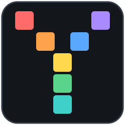
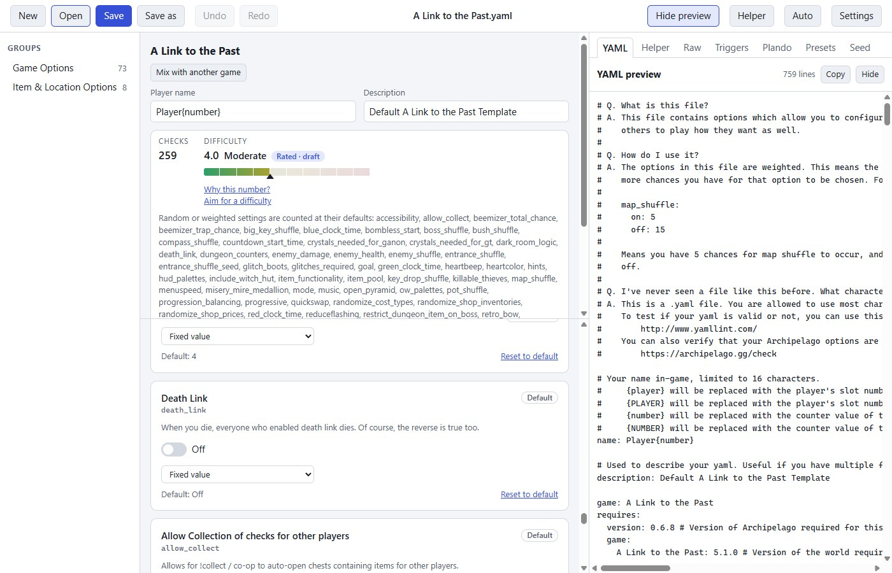
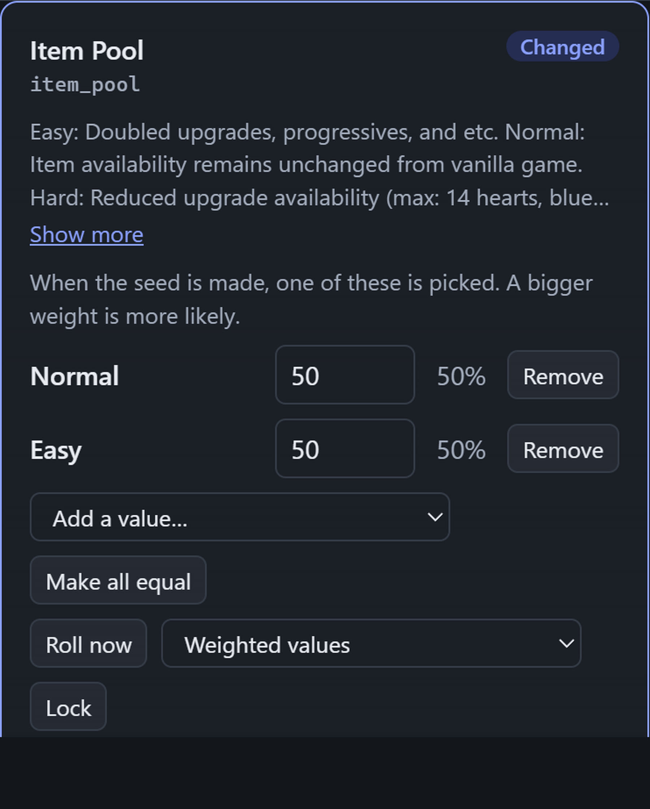
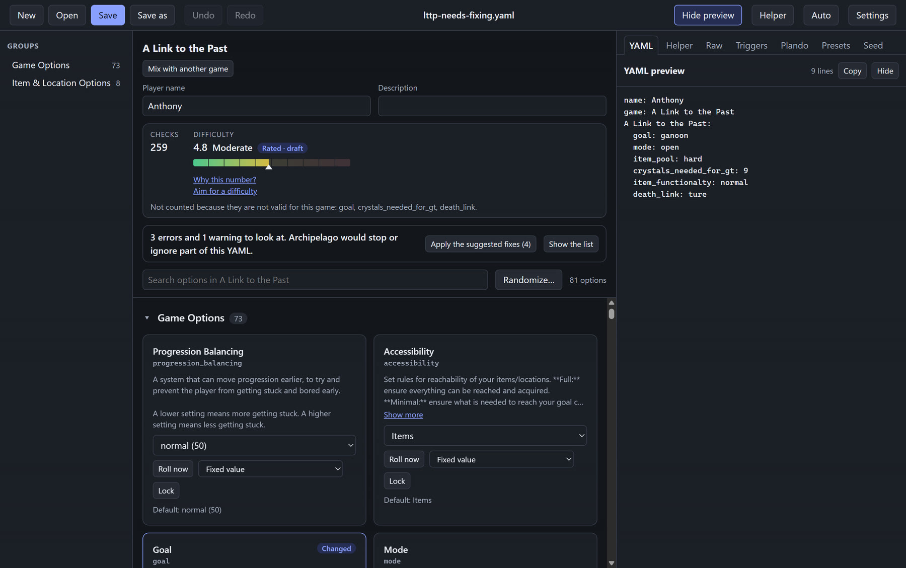
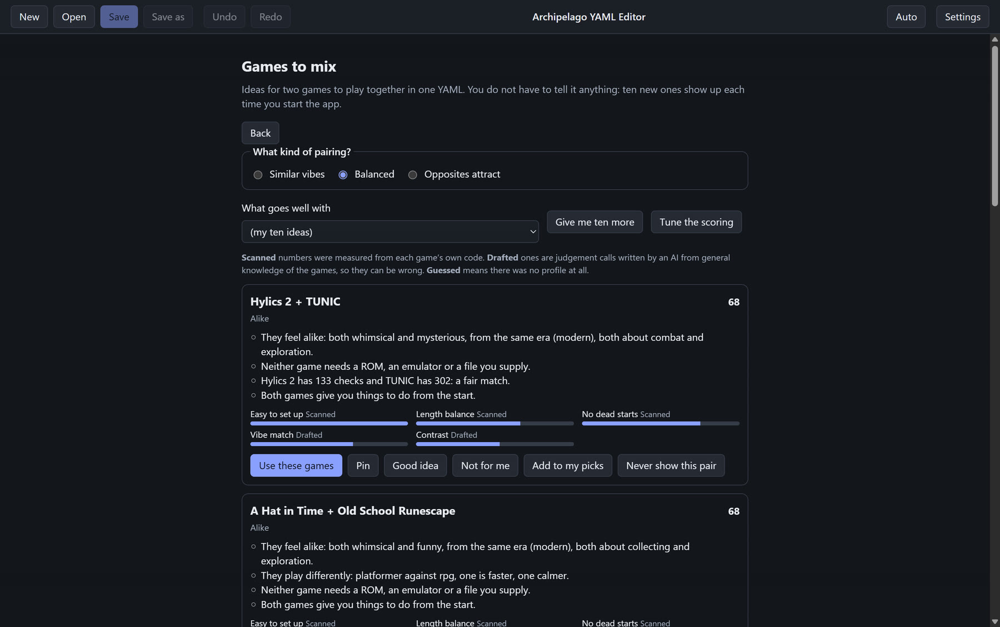
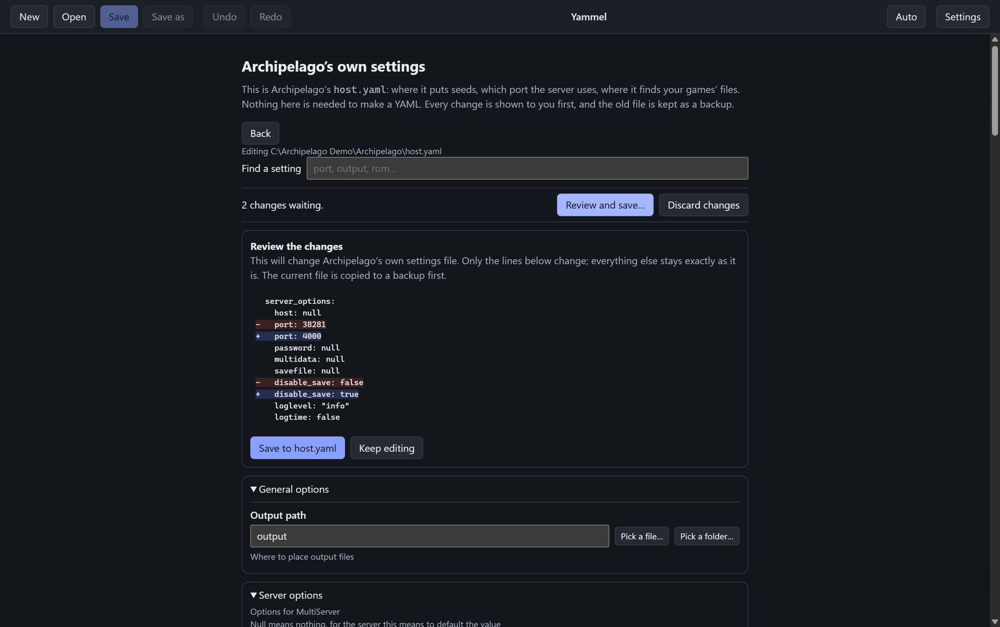

<p align="center">
  
</p>

<h1 align="center">Yammel</h1>

<p align="center">
  <strong>Make Archipelago player files without ever hand-editing text.</strong><br>
  Every option of every game, checked the way Archipelago will check it.
</p>

<p align="center">
  <a href="https://github.com/baconspaceman/yammel/actions/workflows/ci.yml"></a>
  <a href="https://github.com/baconspaceman/yammel/releases/latest"></a>
  <a href="LICENSE"></a>
  
  
</p>

<p align="center">
  
</p>

Yammel is a free, open-source desktop app for making the player files (YAMLs) that
[Archipelago](https://archipelago.gg), the multiworld randomizer, uses to build a game. Pick a game, flip switches, set
numbers, and watch the YAML write itself. It tells you what would go wrong in plain words **before** Archipelago stops
with an error, and it can even make a test seed to prove the file works.

**Nothing is required.** There is no account, no login and no API key. The editor works fully offline. A few extras
(a live check count, seed making, custom worlds) use your own copy of Archipelago, and the AI helpers are off until you
switch them on.

## What's new in 0.5.0

0.5.0 is the current release. Download it from the [Releases page](https://github.com/baconspaceman/yammel/releases/latest).
If you build from source, double-click `scripts\run-yammel.cmd` on Windows (see [Run it from source](#run-it-from-source)).

- **Simple view by default.** Every option has a plain status word: **Default**, **Changed**, **Random** or **Chances
  set**. Each card shows one clear control: a switch, a drop-down, a number box or a text box. Click **Advanced view: off**
  beside the search box to show the chances of weighted values, **Roll now** and **Lock** as well.
- **Any YAML opens.** A YAML for a game Yammel has no data for (a custom world you have not added, or one that cannot be
  read) opens with every option read from the file itself, and its comments are kept.
- **Custom worlds, including ones still in development.** Yammel finds a custom world by its game name, loads it through
  Archipelago's own loader and remembers the result. Worlds written for Python 3.12 or later load when the scan uses
  Python 3.13. Custom games get a live check count too.
- **The command line and agent tools work with any world.** `apyaml` finds shipped, custom and template-only games by
  name. It has a simple default and an advanced mode for developers, and it uses the source folder and Python you chose
  in Yammel's Settings.
- **Game data for Archipelago 0.6.8:** 82 games, including the two new ones (Gauntlet Legends and Yu-Gi-Oh! Forbidden
  Memories).
- **Fixes:** warnings about values Archipelago never picks (such as a weight of 0) are gone. Changing one weight no
  longer reorders a whole list or drops its notes. Templates are read more accurately.

The full list is in the [changelog](CHANGELOG.md).

## Contents

- [What's new in 0.5.0](#whats-new-in-050)
- [Download](#download)
- [Quick start](#quick-start)
- [What it can do](#what-it-can-do)
- [What needs what](#what-needs-what)
- [Documentation](#documentation)
- [Run it from source](#run-it-from-source)
- [Command line and agent tools](#command-line-and-agent-tools)
- [Privacy and safety](#privacy-and-safety)
- [Contributing](#contributing)
- [Credits and disclaimer](#credits-and-disclaimer)
- [Licence](#licence)

## Download

Get the latest version from the **[Releases page](https://github.com/baconspaceman/yammel/releases/latest)**.

| File | What it is |
| --- | --- |
| `Yammel-Setup-<version>.exe` | A normal installer. It installs for your own account and does not need administrator rights. |
| `Yammel-Portable-<version>.exe` | One file you can run from anywhere, for example a USB stick. Nothing is installed. |
| `SHA256SUMS.txt` | Checksums, so you can confirm a download is the one that was built. |

> **Windows may say "unknown publisher" (SmartScreen).** The downloads are not code-signed, because a signing
> certificate costs money every year. Choose **More info**, then **Run anyway**. The whole source code is in this
> repository and the releases are built by [GitHub Actions](.github/workflows/release.yml) from a tagged commit, so you
> can check what you are running, or build it yourself ([instructions](docs/development/building-and-running.md)).

Windows is the supported platform. The code is cross-platform Electron, and it may run elsewhere from source, but that is
not tested.

## Quick start

1. Start the app and click a game on the start screen (or **Open a YAML file** if you already have one).
2. Change the options you care about. The YAML on the right updates as you go. Anything you leave alone keeps the game's own default.
3. Look at the line under the name fields: it says **No problems found** or tells you, in plain words, what to fix, usually with a one-click fix.
4. Press **Save**. The old file is backed up first.

New here? Read **[Getting started](docs/guide/getting-started.md)**. It takes about five minutes.

## What it can do

### Make a YAML



- **Every option of every bundled game** (82 games) as a switch, choice, number or text box, with the game's own
  descriptions, grouped and searchable, and a live YAML preview.
- **Open, edit and save** existing YAMLs safely. Undo and redo for every change. Recent files on the start screen.
- **Weighted values** (in the Advanced view, with each value's chance as a percentage), item and location pickers that
  use the game's real names, **mixing several games** in one YAML, and a **Raw tab** for everything else (your comments
  are kept).
- **Presets**: each game's own presets (for example Stardew Valley's Easy to Maxsanity) and your own named presets.
- **Files with several players** (`---` between them) ask which player to edit, or split into one file each.
- **Groups of games**: besides pairs, Games to mix can find groups of three to eight games that suit each other, with must-include and leave-out choices and the weakest pair named.
- **Triggers and plando**: a **Triggers** tab ("when this option rolls this value, change those") and a **Plando** tab (place items where you want them, choose which door leads where, or replace a text in A Link to the Past), with the game's real item, location and entrance names, a note when Archipelago's `host.yaml` has item plando switched off, and checks confirmed against Archipelago's own code.
- **Custom worlds**: point it at a folder of `.apworld` files and those games appear like any other, each with a
  starter YAML. **Any YAML opens**, even for a game Yammel has no data for: its options are read from the file itself,
  and its comments are kept.

Guides: [Editing options](docs/guide/editing-options.md), [Files and saving](docs/guide/files-and-saving.md),
[Ideas and shortcuts](docs/guide/ideas-and-shortcuts.md), [Triggers and plando](docs/guide/triggers-and-plando.md), [Custom worlds](docs/guide/custom-worlds.md).

<br clear="right">

### Check your work



- **A problem checker** that reads the YAML the way Archipelago will: a typo in a choice, a number out of range, a
  misspelled option, a switch set to `ture`, a random range with a minus sign. Most problems have a one-click fix, and
  the rules were checked against Archipelago's own option code on more than 22,000 values.
- **A live check count** using Archipelago's own world code, so you know how many checks your settings give.
- **A 0 to 10 difficulty gauge** with a **Why this number?** breakdown. Drafted ratings are labelled as drafts.
- **Aim for a difficulty**: drag a slider and see the option changes that get close, before anything is applied.
- **Make a seed**: runs Archipelago's real generator on your YAML, either as a test that writes nothing, or as a real seed.

Guides: [Checking your work](docs/guide/checking-your-work.md), [Problem checker rules](docs/reference/validator-rules.md).

<br clear="right">

### Find ideas



- **Randomize** one option or everything, with locks and an optional difficulty band.
- **Game roulette**: one to ten random games, with a YAML for each.
- **Games to mix**: ten pairings of two games each time, with the reasons shown and sliders to change what counts.
- **A helper chat**: say what you want ("turn off death link", "make it a bit harder"), see the change, press **Apply**.
  The built-in guide runs on your computer and sends nothing anywhere. Claude Code, Codex or your own OpenRouter key can
  be switched on for open-ended requests. The chat can **pop out** into its own window beside the editor.

Guides: [Ideas and shortcuts](docs/guide/ideas-and-shortcuts.md), [The helper](docs/guide/helper.md).

<br clear="right">

### Look after your setup



- **Archipelago's own settings** (`host.yaml`) as a form with the file's own explanations. You see exactly which lines
  change before anything is written, the old file is backed up, and comments and line endings are kept.
- **Light, dark or automatic** look, from the toolbar or Settings.
- **Accessible**: every screen is checked for overlapping text, unnamed controls, low contrast and invisible keyboard focus.

Guides: [Archipelago's settings (host.yaml)](docs/guide/archipelago-settings-host-yaml.md),
[Settings and appearance](docs/guide/settings-and-appearance.md).

<br clear="right">

See every screen in the **[screenshot tour](docs/screenshot-tour.md)**, or the full [feature list](CHANGELOG.md).

## What needs what

The editor itself needs nothing. These extras need something you may already have:

| Feature | Needs | Without it |
| --- | --- | --- |
| Editing, saving, problem checker, randomize, roulette, games to mix, presets, difficulty gauge, built-in helper | Nothing | Works |
| Live check count | An Archipelago **source** folder with its Python environment, chosen in Settings | The count says it is unavailable; everything else works |
| Make a seed | The same, or an installed Archipelago (with its `host.yaml`) | The Seed tab explains what is missing |
| Custom worlds scan | The same source folder and Python. Worlds written for Python 3.12 or later need a Python 3.13 chosen under **Python program** | The Settings section explains what is missing |
| Edit `host.yaml` | An installed Archipelago or a source folder that has a `host.yaml` | The page says none was found |
| AI helpers | Your own Claude Code or Codex login, or an OpenRouter key | The built-in guide still works |

How these are found, and how to set them up: [Settings and appearance](docs/guide/settings-and-appearance.md).

## Documentation

Everything is written for people who play Archipelago, not for programmers, unless it says "Development".

| Start here | |
| --- | --- |
| [Documentation index](docs/README.md) | Every document, in order |
| [Getting started](docs/guide/getting-started.md) | Make your first YAML |
| [Troubleshooting](docs/guide/troubleshooting.md) | Problem, what it means, what to do |
| [FAQ](docs/guide/faq.md) | Quick answers |

| User guide | Reference | Development |
| --- | --- | --- |
| [Getting started](docs/guide/getting-started.md) | [Command line and MCP](docs/reference/command-line-and-mcp.md) | [Architecture](docs/development/architecture.md) |
| [Editing options](docs/guide/editing-options.md) | [Settings and files](docs/reference/settings-and-files.md) | [Building and running](docs/development/building-and-running.md) |
| [Checking your work](docs/guide/checking-your-work.md) | [Keyboard shortcuts](docs/reference/keyboard-shortcuts.md) | [Testing](docs/development/testing.md) |
| [Files and saving](docs/guide/files-and-saving.md) | [Problem checker rules](docs/reference/validator-rules.md) | [Contributing](CONTRIBUTING.md) |
| [Ideas and shortcuts](docs/guide/ideas-and-shortcuts.md) | | [Security](SECURITY.md), [Privacy](PRIVACY.md), [Code signing](docs/development/code-signing.md) |
| [The helper](docs/guide/helper.md) | | [Code of conduct](CODE_OF_CONDUCT.md) |
| [Custom worlds](docs/guide/custom-worlds.md) | | [Changelog](CHANGELOG.md) |
| [Triggers and plando](docs/guide/triggers-and-plando.md) | | |
| [Archipelago's settings](docs/guide/archipelago-settings-host-yaml.md) | | |
| [Settings and appearance](docs/guide/settings-and-appearance.md) | | |

## Run it from source

You need [Node.js](https://nodejs.org) 22 or newer. For the optional extras you also need an Archipelago source folder
with its Python environment (see [What needs what](#what-needs-what)).

```bash
git clone https://github.com/baconspaceman/yammel.git
cd yammel
npm ci
npm run dev
```

| Command | What it does |
| --- | --- |
| `npm run dev` | Starts the app with live reload |
| `npm run bundle` then `npm start` | Builds, then runs the built app |
| `npm test` | Unit tests |
| `npm run e2e` | Builds, then runs the end-to-end tests that drive the real app |
| `npm run typecheck` | TypeScript check |
| `npm run dist` | Builds the Windows installer and the portable exe into `dist/` |
| `npm run cli:build` | Builds the command line tool |
| `scripts\run-yammel.cmd` | Windows: builds, then opens the app. Double-click it |

More in [Building and running](docs/development/building-and-running.md) and [Testing](docs/development/testing.md).

## Command line and agent tools

The same logic that powers the app is available without opening a window, as the `apyaml` command line tool and an MCP
server, so scripts and AI coding agents can make, vary, check and rate YAMLs. It works with shipped games, custom worlds
and worlds still in development. This is handy when you are building an Archipelago world and need many test YAMLs.

```bash
npm run cli:build
node out/cli/apyaml.mjs games                                   # list the games
node out/cli/apyaml.mjs options "A Link to the Past"            # its options
node out/cli/apyaml.mjs new "A Link to the Past" --out lttp.yaml
node out/cli/apyaml.mjs new "Balatro" --randomize --seed 7      # a custom world, found by its name
node out/cli/apyaml.mjs worlds --advanced --scan                # developers: every world file and whether it loaded
node out/cli/apyaml.mjs mcp                                     # run as an MCP server
```

Simple mode is the default and needs no setup. `--advanced` adds diagnostics and the developer options (extra world
folders, a template YAML to read the options from, and rescans). Every command prints one line of JSON and sets an exit
code. All randomness is seeded and reported, so any result can be reproduced. Full reference:
[Command line and MCP](docs/reference/command-line-and-mcp.md).

## Privacy and safety

- **Your YAMLs stay on your computer.** Nothing is uploaded, and there is no telemetry.
- **The AI helpers are off until you switch one on**, and each one asks for your consent first. When one is on, your
  message and the open YAML go to that service, using your own login or key. An OpenRouter key is kept encrypted by
  your operating system and is never shown again.
- **The editor never changes your Archipelago install** without showing you the exact change and making a backup first.
- **Custom worlds run their own code** when scanned, exactly as the Archipelago launcher does. Only choose a folder you trust.
- The app's windows are sandboxed, can only act through a short list of allowed calls, and never receive file paths from
  the page. Details: [Architecture](docs/development/architecture.md) and [SECURITY.md](SECURITY.md).

Found a security problem? Please report it privately: see [SECURITY.md](SECURITY.md).

## Contributing

Bug reports, ideas, new game ratings and code are all welcome. Please read [CONTRIBUTING.md](CONTRIBUTING.md) first. The
project has one hard rule: **nothing may become required.** No account, key, login or extra program.

The project has over 1,200 unit tests and about 190 end-to-end tests that drive the real app, including checks that every
screen has no overlapping text and passes an accessibility audit in both looks.

## Credits and disclaimer

- **The name:** Yammel is a play on YAML, the file format Archipelago uses for player files. Version 0.1.0 was published
  as "Archipelago YAML Editor"; it is the same project under its new name.
- This is an independent tool. It is **not affiliated with, endorsed by or part of the Archipelago project**.
  "Archipelago" and the names of games and worlds belong to their owners.
- It reads Archipelago's own option definitions (Archipelago is MIT licensed) so that what you edit matches what the
  generator will accept. The bundled option data was extracted from Archipelago 0.6.8.
- Built with [Electron](https://www.electronjs.org), [React](https://react.dev), [Vite](https://vite.dev) and
  [yaml](https://eemeli.org/yaml/). The logo is original artwork.

## Licence

[MIT](LICENSE). You may use, copy, change and share this code, including for commercial purposes, as long as the licence
notice stays with it.
