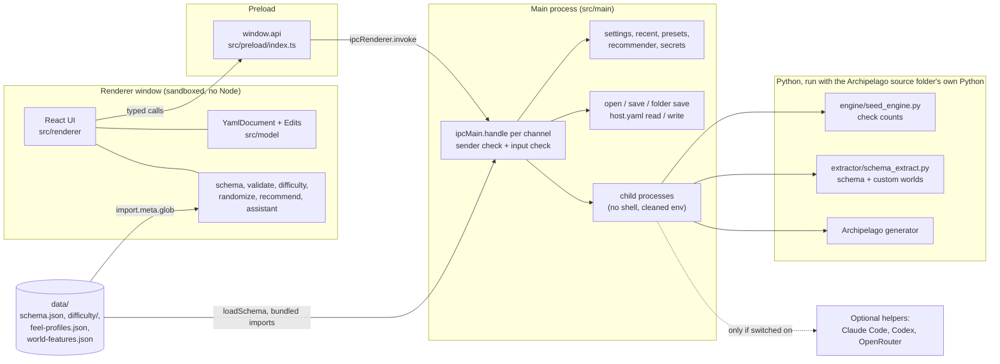

# Architecture

A developer's map of Yammel: the layers, the Python pieces, the data files, the typed IPC and its security model, the document model, and how two of the trickier flows work.

Contents:

- [Layers](#layers)
- [Diagram](#diagram)
- [Python pieces](#python-pieces)
- [Data files](#data-files)
- [Typed IPC](#typed-ipc)
- [Security model](#security-model)
- [Document model](#document-model)
- [One conversation, two windows (helper pop-out)](#one-conversation-two-windows-helper-pop-out)
- [How a custom world scan flows](#how-a-custom-world-scan-flows)
- [Module map](#module-map)

## Layers

The app is Electron with a React renderer, built by `electron-vite`. All code is TypeScript. The project folder has four source layers, plus Python and data.

| Layer | Folder | What it does |
|---|---|---|
| Main process | `src/main` | Runs with full Node and operating system access. Owns every file read and write, file dialogs, child processes (the check engine, the seed generator, the custom-world scanner, the optional AI helpers), settings, and both windows. Registers every IPC handler in `src/main/index.ts`. |
| Preload | `src/preload` | One small script (`src/preload/index.ts`). It builds the `api` object and hands it to the page with `contextBridge.exposeInMainWorld('api', api)`. Each method is a single `ipcRenderer.invoke` on a fixed channel name. |
| Renderer | `src/renderer` | The React user interface. It runs in a sandboxed page with no Node access and reaches the outside world only through `window.api`. |
| Shared | `src/shared` | Types and small pure functions that both sides import: the API contract (`api.ts`), settings (`settings.ts`), host.yaml types (`host.ts`), generator types (`generate.ts`), custom-world types (`customWorlds.ts`) and the helper pop-out messages (`popout.ts`). |

Everything else under `src` is plain TypeScript with no Electron dependency (the document model, the schema loader, the validator, the difficulty and recommendation code, the command-line tool). That code is imported by the renderer, and some of it by the command-line tool, and is tested with Vitest. See the [module map](#module-map).

The build output goes to `out/`. Main and preload are built as CommonJS (`.cjs`) because a sandboxed preload script cannot be an ES module (see `electron.vite.config.ts`).

## Diagram

## Python pieces

Both Python programs are run with the Python of an Archipelago **source** folder (its `.venv`), never with the installed launcher version. They are optional: without them the editor still works, minus the live check count, the generator and custom-world scanning.

- **`engine/seed_engine.py`** (check counts). A long-running process that loads every world once, then answers requests. The protocol is one JSON object per line on stdin and one per line on stdout; the first line it writes is `{"event": "ready", ...}`, and anything the worlds themselves print goes to stderr. It runs only Archipelago's early generation steps (no fill) and never writes a file. Its arguments are `--ap-root` (required) and `--scan-all OUT` (scan every world once, write the facts to `OUT`, exit). `src/main/engine.ts` starts it on demand, restarts it a limited number of times after crashes, stops it after an idle period (default five minutes, overridable with `ARCHIPELAGO_ENGINE_IDLE_MS`), and always stops it on quit.
- **`extractor/schema_extract.py`** (schema and custom worlds). Reads every world's option classes and writes one JSON file. Arguments: `--ap-root` (required), `--out` (required), `--custom-worlds FOLDER` (also load the `.apworld` files in that folder) and `--only-custom` (write only the games that came from that folder). It writes `data/schema.json` when run by hand (see [building-and-running.md](building-and-running.md)) and a per-user custom schema when run by the app (see [custom world scan](#how-a-custom-world-scan-flows)).
- **Seed generation** (Make a seed) runs Archipelago's own generator. `src/main/generate.ts` decides what to launch and `src/shared/generate.ts` holds the request and result types.

The source folder is found by `src/main/detect.ts` in this order: the folder chosen in Settings, else the `ARCHIPELAGO_AP_ROOT` environment variable, else an `archipelago-dev/Archipelago` folder next to the project folder. Only the first one that is set is looked at; a set but wrong folder is reported, not silently replaced.

## Data files

| File or folder | What it holds | Produced by |
|---|---|---|
| `data/schema.json` | Every bundled game's options (kinds, defaults, descriptions, groups, presets). Read by `loadSchema` and parsed by `src/schema/load.ts`. | `extractor/schema_extract.py`, run by hand (`scripts/extract-schema.ps1`). |
| `data/world-features.json` | Per game: check and item counts, how much is open at the start, whether a ROM or other file is needed, emulator systems. Used by the Games to mix recommender. | `engine/seed_engine.py --scan-all` (`scripts/scan-worlds.ps1`). |
| `data/feel-profiles.json` | Drafted "what is this game like" profiles used by the recommender. | `scripts/make-feel-profiles.py` (edit the table in the script and re-run). |
| `data/difficulty/*.json` | Hand-drafted difficulty profiles, one file per game. Bundled with `import.meta.glob` in `src/difficulty/shipped.ts`. | Written by hand. |

At run time the schema path is `data/schema.json` under the app path, or the file named by `ARCHIPELAGO_YAML_SCHEMA` (used by tests to swap in a small schema). The window receives the schema as text through `loadSchema`; when a custom-worlds scan exists for the chosen folder, `schemaWithCustom` in `src/main/customWorlds.ts` merges the scanned games in first.

## Typed IPC

The contract lives in three files:

- **`src/shared/api.ts`** defines `EditorApi` (every call the window can make, with doc comments), the `IPC` table that maps each call to a channel name such as `file:open` or `engine:count`, and the request and result types. Most calls return `ApiResult<T>`, which is `{ ok: true, value }` or `{ ok: false, message }` with a message that is safe to show a person. Calls that can fail in expected ways (counting checks, generating) return their own result unions and never throw.
- **`src/preload/index.ts`** implements `EditorApi` as a plain object where each method is one `ipcRenderer.invoke(IPC.<name>, ...)`. The three event subscriptions (`onHelperSnapshot`, `onHelperAction`, `onHelperWindow`) pass on only the data, never the event object, and return a function that stops listening.
- **`src/main/index.ts`** registers one `ipcMain.handle` per channel in `registerIpc`.

To add a call: add the method and channel to `src/shared/api.ts`, add the one-line forward to `src/preload/index.ts`, then add a handler in `src/main/index.ts` that checks the sender and the input before doing anything. TypeScript will flag a missing piece because the preload object is typed as `EditorApi`.

## Security model

The renderer is treated as untrusted. The rules below are enforced in `src/main` and are the reason the IPC surface looks the way it does.

- **Only listed calls.** The window can do nothing the `EditorApi` list does not name. There is no generic "run this" or "read this path" call.
- **The window never supplies file paths.** Paths come from dialogs that the main process shows (`dialog.showOpenDialog`, `showSaveDialog`) or from what the main process detected itself. The main process remembers the paths it returned (`approvedPaths` for YAML files, `approvedSettingPaths` for folders and programs picked for settings, `approvedPlayerFiles` for extra player YAMLs, `seedFolders` for seeds it wrote). A later request that names a path is honoured only if that path is in the matching set; for example, a save to an unknown path falls back to the Save dialog, and `revealSeed` only shows folders this app wrote a seed into. Recent files are reopened only if the path is in the recent list.
- **Sender checks.** Handlers check `event.senderFrame` against the main frame of the expected window (`fromOurWindow` for the editor window, `fromHelperWindow` for the pop-out). The pop-out can only call a few helper-related channels; most calls are refused for it.
- **Pick-only paths.** Settings that point at folders or programs (the Archipelago source folder, the Python program, the custom worlds folder, host.yaml paths) can only be changed to a value the person chose in a picker. The Python picker also requires a file named `python` or `python.exe`.
- **Input checks.** Every request is validated before use: `src/main/countRequest.ts` for check counts, `isSaveRequest` for saves, `src/main/folderSave.ts` for folder saves, `parseHelperAction` and `isSendableSnapshot` in `src/shared/popout.ts` for the pop-out, and cleaning plus size limits in the JSON stores (`src/main/jsonStore.ts`) for presets, recent files and recommender state.
- **No shell.** Child processes are started with `spawn(..., { shell: false })` and an argument list (`src/main/helpers/cli.ts`, `src/main/engine.ts`). The app never builds a shell command line. For this reason a program is only found on the `PATH` if it is a real `.exe` on Windows.
- **Cleaned environment.** Before a child process starts, `cleanEnv` in `src/main/helpers/cli.ts` removes variables that would make a helper fall back to a pay-per-use key or another account (for example `ANTHROPIC_API_KEY` and `OPENAI_API_KEY`; read the `REMOVED` list for the full set). The generator and the custom-world scanner use the same function.
- **Sandboxed windows.** Both windows are created with `contextIsolation: true`, `nodeIntegration: false` and `sandbox: true`. Both deny `window.open` (`setWindowOpenHandler` returns `deny`) and cancel every navigation (`will-navigate`), so a window can only ever show the app's own page. All permission requests (camera, notifications and so on) are denied for every session.
- **Content Security Policy.** `src/renderer/index.html` sets `default-src 'self'; script-src 'self'; ... connect-src 'self'; object-src 'none'; base-uri 'none'; form-action 'none'`, so the page cannot load remote scripts or make requests to other hosts. The only network request in the code is the optional OpenRouter helper call, which is made by the main process (`src/main/helpers/providers.ts`) and only when that helper is switched on and has a key.
- **Secrets.** The OpenRouter key, if the person saves one, is encrypted with Electron's `safeStorage` (`src/main/helpers/secrets.ts`) and is never sent back to the window. The settings file holds folder paths and switches only.
- **Safe writes.** `src/main/files.ts` copies the previous file to a backup under the app's data folder before replacing it. `writeHost` refuses to write if host.yaml changed since it was read.

See also [SECURITY.md](../../SECURITY.md).

## Document model

`src/model` is the heart of editing.

- **`YamlDocument`** (`src/model/document.ts`) is a typed facade over the `yaml` library's `Document`, parsed as YAML 1.1 because Archipelago reads player files with PyYAML (an unquoted `on` or `yes` is a boolean there). Because the `Document` is never rebuilt, comments, key order and keys the app does not know about (triggers, plando, meta) survive. Until the first edit lands, `toString()` returns the original text byte for byte, so opening and saving without changes cannot reformat a file. Output never folds long lines.
- **`Edit`** (`src/model/edits.ts`) is the typed operation. Every change to a YAML is one of: `set`, `reset`, `setWeights`, `setMeta`, `removeGame`, `replaceText` (the raw view; it must be alone in its batch) or `setGameWeights`. The interface, presets, the validator's suggested fixes, randomize, the difficulty aimer and the AI helper all produce `Edit`s, so there is one path for undo and suggestions can be previewed before they are applied. A bad edit throws `EditError` with a plain message.
- **Undo.** `EditorSession` (`src/renderer/state/session.ts`) holds one open YAML: the document, its undo and redo history, and where it is saved. Views read from the session and re-render when it notifies; they keep no copy of values. A batch of edits (for example "Apply the suggested fixes") is one undo step.
- **Several players in one file.** `src/model/multiDoc.ts` splits a `---` separated file into parts so the person can pick one to edit or save each as its own file; the original is not changed.

## One conversation, two windows (helper pop-out)

The helper chat can move into its own window. Both windows load the same page; `src/renderer/main.tsx` renders `HelperPopout` instead of `App` when the URL has `?view=helper`. The editor window stays the single owner of the conversation and the open YAML.

1. The editor window (`App.tsx`) builds a `HelperSnapshot` (entries, starters, busy flag, helper choices, selected helper, note, settled proposals) and, while the pop-out is open, sends it with `publishHelper`. The main process checks the sender and `isSendableSnapshot` (plain data, at most `MAX_SNAPSHOT_BYTES`), stores it, and forwards it to the pop-out as a `helperwin:snapshot` event.
2. The pop-out (`src/renderer/components/HelperPopout.tsx`) listens with `onHelperSnapshot`, and asks for the latest copy once with `getHelperSnapshot` when it opens. It renders the same `AssistantPanel`.
3. What the person types or clicks in the pop-out becomes a `HelperAction` (`send`, `helper`, `apply`, `skip`, `point`, `clear`) sent with `sendHelperAction`. The main process accepts it only from the pop-out, runs it through `parseHelperAction` (anything that is not exactly one known action is refused; text is length limited), then forwards it to the editor window as a `helperwin:do` event.
4. `App.tsx` handles each action with the same code the in-window chat uses, so changes land in the open YAML as ordinary `Edit`s and undo works. "Show me" (`point`) also focuses the editor window.
5. The pop-out is told about open and close through `onHelperWindow`. Closing the editor window closes the pop-out and clears the stored snapshot.

The channel names are in the `IPC` table (`helperwin:open`, `helperwin:close`, `helperwin:is-open`, `helperwin:publish`, `helperwin:get`, `helperwin:action`, `helperwin:snapshot`, `helperwin:do`, `helperwin:state`).

## How a custom world scan flows

Custom worlds are `.apworld` files the person has in a folder. Scanning needs an Archipelago source folder and its Python (`scanBlocker` explains why a scan cannot run).

1. In Settings the person picks the folder (`pickCustomWorlds`, which only returns a path from a dialog) and saves it with `saveSettings`.
2. `scanCustomWorlds` (IPC channel `custom:scan`) in `src/main/index.ts` checks the sender, requires a chosen folder that exists, and allows one scan at a time (an `AbortController` backs `cancelScan`).
3. `scanCustomWorlds` in `src/main/customWorlds.ts` runs `extractor/schema_extract.py` with the source folder's Python and `--ap-root`, `--custom-worlds <folder>`, `--only-custom` and `--out <userData>/custom-worlds/schema.json.part`, with a cleaned environment, a fifteen minute limit and an output size limit. Loading a world runs that world's own code, as the Archipelago launcher would; the folder itself is only read.
4. On success the output must be at most `MAX_CUSTOM_SCHEMA_BYTES`. It is parsed, summarised (`summarize`: the games found and, per file, a problem sentence from `plainProblem`), renamed to `schema.json`, and `summary.json` is written next to it, both under the app's user data folder in `custom-worlds`. On any failure the `.part` file is removed and the previous scan, if any, is kept.
5. `loadSchema` returns the bundled schema with the scanned games merged in (`mergeSchemaText`). A custom game never replaces a bundled one. The merged text is checked with `parseSchemaFile`, and a damaged scan falls back to the bundled schema so the editor always starts.
6. `customWorldsStatus` reports the folder, whether a scan can run, whether one is running and the last summary (only used if it is for the currently chosen folder). The renderer side is `src/renderer/components/CustomWorldsSection.tsx`.

## Module map

One line per folder under `src/`.

| Folder | Purpose |
|---|---|
| `src/assistant` | The helper's brain: the built-in guide (`guide.ts`, which needs nothing installed), matching, nudges, and the proposal and reply types. Replies are proposals that become `Edit`s. |
| `src/cli` | The `apyaml` command line tool and MCP server: argument parsing, the command table, YAML building, value parsing, and Node file access. Built to a single file by `vite.cli.config.ts`. |
| `src/difficulty` | The difficulty gauge: profile types and validation, the scorer, rule-based estimates for games without a profile, labels, and the registry that bundles `data/difficulty/*.json`. |
| `src/hostyaml` | The model behind the host.yaml form: parses Archipelago's `host.yaml` into typed entries and works out line changes, keeping comments and line endings. |
| `src/main` | Electron main process: IPC handlers, windows, engine, generator, detection, stores, file saving, custom worlds scanning, host.yaml file access. |
| `src/main/helpers` | The optional AI helpers: provider calls (Claude Code, Codex, OpenRouter), the helper service and status, the key store, and the no-shell program runner with `cleanEnv`. |
| `src/model` | `YamlDocument`, the `Edit` type and multi-player file splitting. |
| `src/preload` | The `window.api` bridge. |
| `src/presets` | Game presets and the person's saved presets, turned into `Edit`s. |
| `src/randomize` | Rolling option values, the plan for randomizing everything, and the `random` value forms Archipelago accepts. |
| `src/recommend` | The Games to mix recommender: game facts and feel profiles, pair scoring, selection, and saved state. |
| `src/renderer` | The React UI: `App.tsx`, `main.tsx`, `components/` (screens and panels, with `components/controls/` for option editors), `state/` (editor session, helper state, check counter, option helpers) and `styles/`. |
| `src/roulette` | Game roulette: seeded random picking and YAML making for a set of games. |
| `src/schema` | The option schema types and the loader and validator for `schema.json`. |
| `src/shared` | The IPC contract and types shared by main, preload and renderer. |
| `src/validate` | The problem checker: reads a YAML the way Archipelago will and returns issues with suggested fixes. |

Files at the root of `src`: `index.ts` re-exports the model and schema types for other code to import, and `test-setup.ts` is the Vitest setup file that cleans up rendered components after each test.
