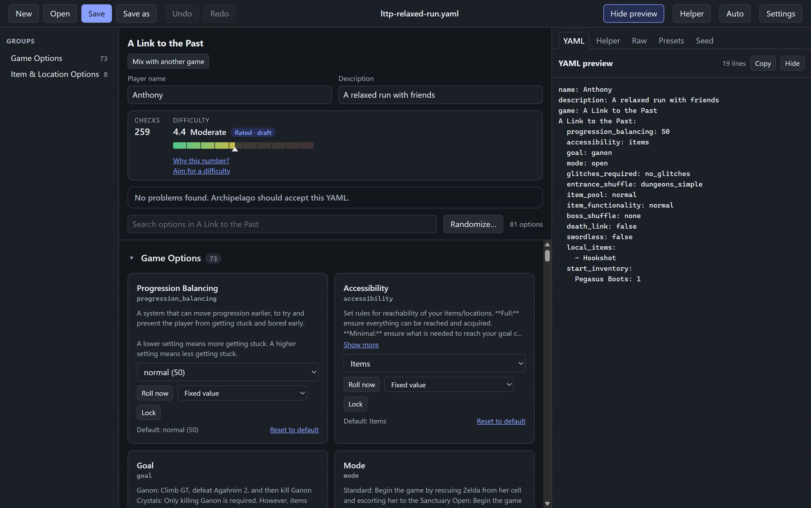
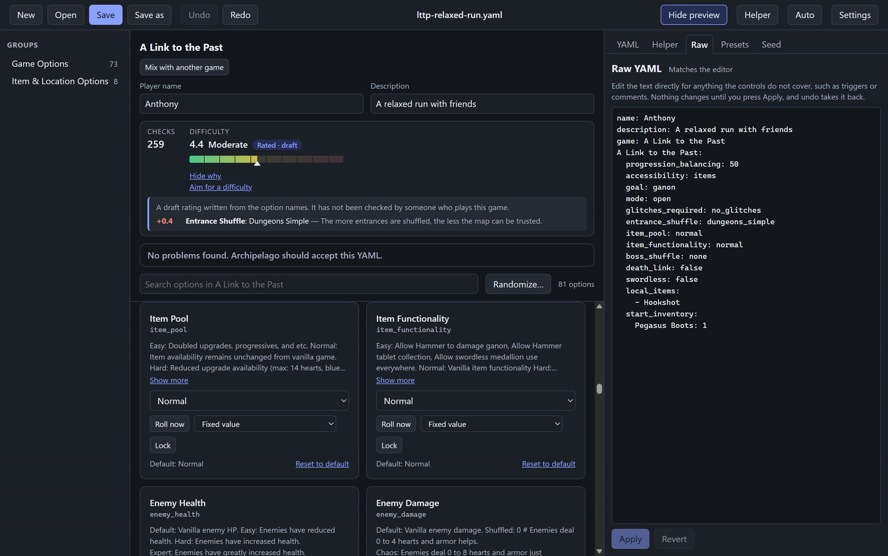

# Editing options

This guide walks through the editor screen: the group list, the option cards, how each value is decided, lists, the YAML and Raw tabs, and undo.

Contents:

1. The editor screen
2. Option cards
3. Switches, choices, numbers and text
4. How a value is decided
5. Weighted values
6. Lists and pickers
7. Player name, description and mixing games
8. The YAML tab
9. The Raw tab
10. Undo and redo

## The editor screen

The editor has four main parts:

- **The toolbar** across the top. It has **New**, **Open**, **Save**, **Save as**, **Undo**, **Redo**, the file name, **Show preview** or **Hide preview**, **Helper**, a **Look** button that switches between Auto, Light and Dark, and **Settings**.
- **Groups** on the left. This list shows the option groups for the game. Click a group to jump to it.
- **The option cards** in the middle. Each option of the game is a card. A search box, **Search options in** the game name, sits above them. If nothing matches, the editor says **No options match** and the word you searched for.
- **The side panel** on the right. Its tabs are **YAML**, **Helper**, **Raw**, **Presets** and **Seed**.

## Option cards

Each card shows:

- The option's name, and a **Changed** badge when your value differs from the default.
- A short description. Long descriptions have a **Show more** button, and **Show less** to fold them again.
- The control you use to set the value.
- **Default:** followed by the game's default, so you can see what you would get without a change.
- **Reset to default**. This button appears when the option is written in your YAML. Clicking it removes the option, so the game's default applies again.
- Any problems the checker found with this option, with one-click fix buttons. See [checking your work](checking-your-work.md).

## Switches, choices, numbers and text

The control depends on the kind of option:

- **Switch** for options that are on or off. It is shown as a switch you click.
- **Choice** for options that have a fixed list of values. It is a drop-down list.
- **Number** for options that take a whole number. Some numbers also have named values, which appear as a drop-down.
- **Text** for options that take words, such as a name or a message.

## How a value is decided

Every option card has a row under the value. It holds:

- **Roll now**. This picks a real value at random right now and writes it into your YAML. Use it when you want to try a value. Your YAML keeps the value it picked, not a random rule.
- **How the option is decided**, a drop-down with these choices:
  - **Fixed value**. You choose the value, and it is the same every time.
  - **Random**. Archipelago picks any of the choices when the seed is made.
  - **Random, leaning low**, **Random, leaning middle** and **Random, leaning high**. These are for numbers. Archipelago picks a number and leans toward the low, middle or high part of the range.
  - **Random between two numbers**. This is for numbers, and you type a **from** and a **to** number. It is not offered for options that can go below zero, because Archipelago cannot read a random range with a minus sign.
  - **Weighted values**. You give each value a weight. See the next section.
- **Lock**. A locked option is kept out of **Randomize everything**, so it keeps its value.

If the option holds a random form the editor cannot show, the drop-down says **Other (edit it in the Raw tab)**. Use the Raw tab for those.

The random rules are for the seed. The app shows a plain sentence under the value, such as "Random: a whole number from 1 to 5, leaning towards low values, decided when the seed is generated."

## Weighted values

Weighted values let you say which values are more likely. Choose **Weighted values** in the how-decided drop-down.

- The card explains: when the seed is made, one of these is picked, and a bigger weight is more likely.
- Each value has a weight box. Weights are numbers of zero or more.
- Each value shows its chance as a percentage, so you can see the odds at a glance.
- Use **Add a value…** to add another value to the list.
- A weight of 0 means that value is never picked.
- At least one value must have a weight above 0. If none do, the checker reports that the option has no values to pick from.
## Lists and pickers

Some options take a list of names, such as items or locations from the game. For these, the card shows a picker:

- Type to search by name. If the game has no list of names to search, the box says **Type a name and press Enter** instead.
- Chosen names appear in a list. Each one has a **Remove** button.
- When nothing is chosen, the card says **Nothing chosen. The game's default applies.**
- Some lists take group names as well, such as a whole category of items.
- Some lists, such as start inventory, also take a number for each item. Set how many of each item the player starts with.

## Player name, description and mixing games

At the top of the editor you will find:

- **Player name**. This is the name Archipelago shows for you. It cannot be empty. The name **Archipelago** is not allowed. A name longer than the limit is cut short when Archipelago reads it, and the checker warns you about that.
- **Description**. An optional note about the YAML. It is kept in the file.
- **Game**. Shown as the game's name. If the YAML has more than one game, you can pick which one you are editing.
- **Mix with another game**. This button opens the games-in-this-YAML section. Use **Add a game…** to add a second game. Each game in the mix gets its own weight, which is how often Archipelago picks it. At least one game must have a weight above 0.

## The YAML tab

The **YAML** tab shows the text the editor is building. It updates as you change options. You can hide the whole side panel with **Hide preview** in the toolbar, and show it again with **Show preview**.

## The Raw tab

The **Raw** tab is for anything the controls do not cover, such as triggers, plando and comments. It shows the whole YAML as plain text.

- The heading shows **Matches the editor** when the text and the editor agree. It shows **Not applied yet** when you have typed changes that are not applied.
- Nothing changes until you press **Apply**. Undo takes the change back.
- **Revert** throws away your typed changes and shows the current text again.
- **Apply** stays off until something has changed. It also stays off while the text has problems. The problems are listed with their line numbers, for example "Line 12: ...".
- If the text is not valid YAML, or the top of the file does not hold settings, the editor refuses the text and tells you why.
- Comments you type in the Raw tab are kept as you wrote them.
- If the YAML was changed somewhere else while you were typing, the tab says so. Use **Revert** to see the current text.

## Undo and redo

- **Undo** and **Redo** in the toolbar take back and repeat your changes.
- Each change is one undo step. Applying the changes from "Aim for a difficulty" is one step too, and so is an apply from the Raw tab.
- The keyboard shortcuts are Ctrl+Z for undo, and Ctrl+Shift+Z or Ctrl+Y for redo. They do nothing while you are typing in a text box. The full list is in [keyboard shortcuts](../reference/keyboard-shortcuts.md).

## Related guides

- [Getting started](getting-started.md)
- [Checking your work](checking-your-work.md)
- [Files and saving](files-and-saving.md)
- [Ideas and shortcuts](ideas-and-shortcuts.md)
- [Troubleshooting](troubleshooting.md)
- [Validator rules](../reference/validator-rules.md)
