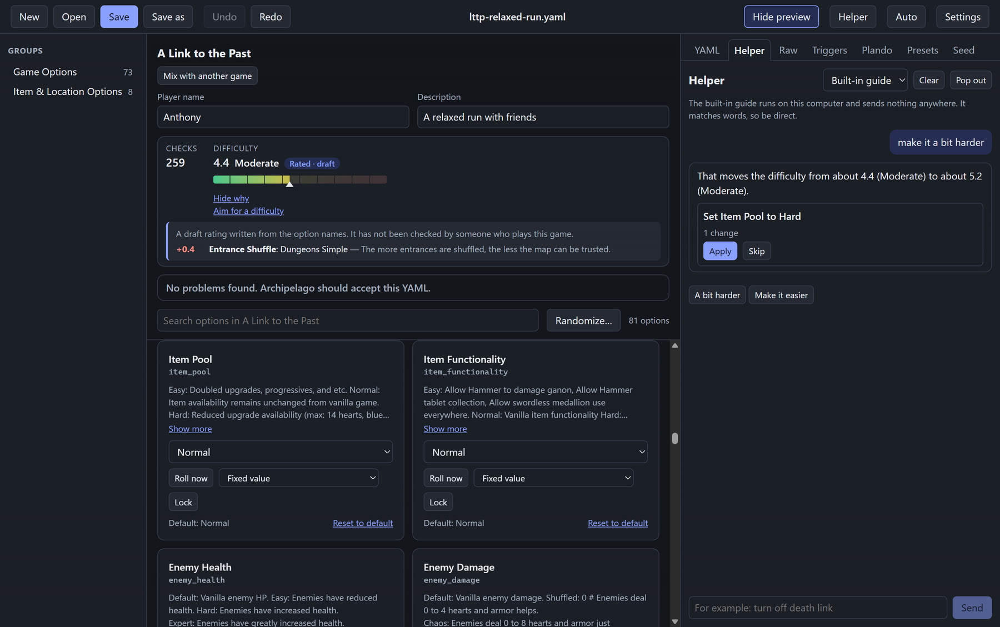
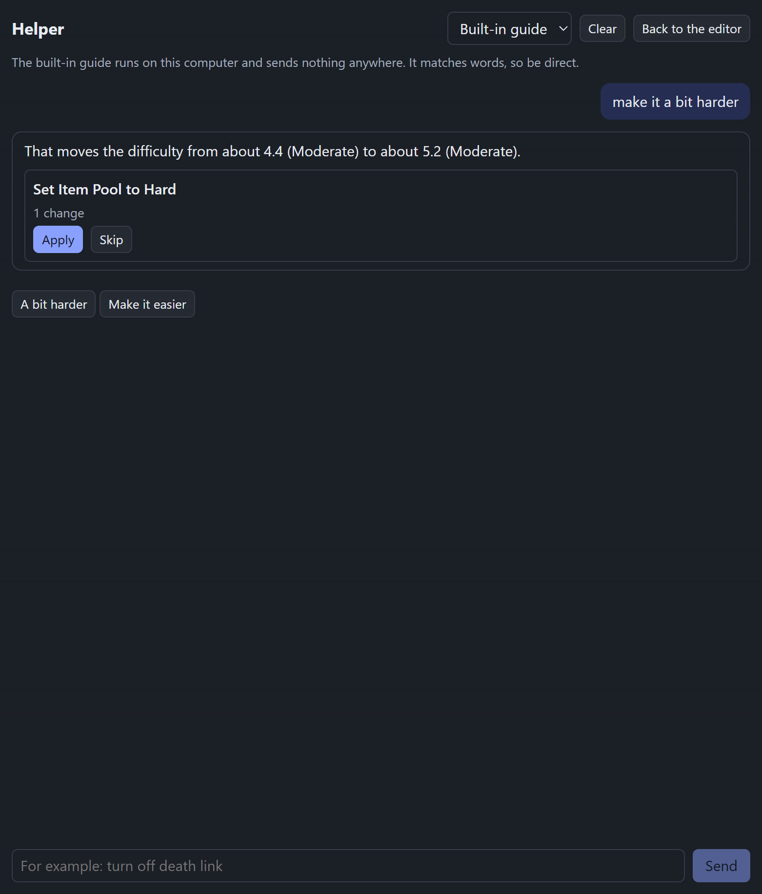

# The Helper

The Helper is a chat beside your YAML. You say what you want in plain words, it shows you the change, and nothing changes until you press **Apply**.

The built-in guide is always available and sends nothing anywhere. Optional AI helpers (Claude Code, Codex or your own OpenRouter key) can understand more open-ended requests, but each one is off until you switch it on.

## Using the built-in guide

The built-in guide runs on your computer. It is not a language model. It reads what you type with plain rules and matches words against the game's option names and descriptions. When it cannot tell what you mean, it says so, and suggests different words or an AI helper.

These are the kinds of things it understands. Examples are taken from how it is tested.

- **Switches:** "turn on swordless", "turn off key drop shuffle", "disable key drop shuffle", "I do not want key drop shuffle, switch it off".
- **Numbers:** "set crystals needed for ganon to 5". If the number is outside the option's range, it uses the nearest allowed value and tells you.
- **Choices:** "set goal to" followed by one of the choices the option lists. Ask "change the goal" and it shows you the choices.
- **Random values:** "make swordless random".
- **Difficulty:** "make it harder", "make it a bit harder", "make it much harder", "make it easier". These only work for games with a difficulty estimate.
- **Problems:** "fix my problems", "are there any errors?".
- **What changed:** "what did I change?" It lists the options you changed from their defaults.
- **Explanations:** "what does goal do?" It gives the option's description, its current value and its choices.
- **Resets:** "reset swordless" puts one option back to its default. "start over" removes every option written in the YAML, so the game uses its defaults.
- **Presets:** "what presets are there?", or "use the [name] preset" for a preset the game ships with.
- **Finding a setting:** "anything about dungeon keys" lists the closest settings, with their current values.
- **Randomize:** "surprise me" re-rolls every option that Randomize everything would touch.
- **Help:** "help" or "what can you do?" shows a short introduction.

Under each reply, the chat offers buttons for things you could say next. These are the built-in guide's own phrases. They include **Fix my problems** (only when there are problems), **Make it easier** and **Make it harder** (when the game has a difficulty estimate), **Surprise me**, **What did I change?**, and "What does [option] do?".

## Apply, Skip, and Show

When the Helper suggests a change, it appears as a card with a title, a short detail, and two buttons:

- **Apply** makes the change in your YAML. You can undo it. The card then says "Applied (you can undo it)".
- **Skip** leaves your YAML alone. The card then says "Skipped".

Nothing is written until you press **Apply**. If the Helper suggests several fixes, it also offers **Apply all** with the number of fixes, and that is one undo step.

Some replies have **Show [option]** buttons. They take you to that option in the editor so you can look at it first.

The built-in guide never proposes a fix that would delete something you wrote. Those problems are left for you to look at in the problem list.

## Optional AI helpers

The AI helpers are off by default. Switch one on in **Settings**, under **Optional AI helpers**. Each one has a checkbox, **Use [name] in the Helper**, and an optional **Model** box. When you switch one on, the app asks you to confirm and says what will be sent.

Once one is switched on and ready, it appears in the **Who answers** menu at the top of the Helper, next to **Built-in guide**. If an AI helper is switched on but not ready, the menu shows it as "(not set up)" and the reason is shown under the chat title.

| Helper | How it is set up | What it needs | What is sent | Who pays |
|---|---|---|---|---|
| Claude Code | Settings, then **Use Claude Code in the Helper** | Claude Code installed and signed in on this computer | Your question, the current YAML, and descriptions and current values of the options that matter to the question | Your own Claude login and plan allowance |
| Codex | Settings, then **Use Codex in the Helper** | Codex installed and signed in on this computer | The same as Claude Code | Your own ChatGPT login and plan allowance |
| OpenRouter | Settings, paste a key into **OpenRouter key**, press **Save key**, then **Use OpenRouter in the Helper** | Your own OpenRouter key | The same, sent to OpenRouter | Your OpenRouter account, a small amount for each question |

Notes on each one:

- **Claude Code and Codex** are run as programs on your computer, using the login you already have. If they are not signed in, the Helper tells you how to sign in.
- **OpenRouter** is called directly from the app. Leave the **Model** box empty for the default model. Each question costs a small amount at OpenRouter's prices, charged to your own OpenRouter account. The app never supplies a key of its own.
- **The key is kept safe.** The app asks your operating system to encrypt it. If the system cannot protect a key, saving is refused. The key is never shown again: the box stays empty, and it says a key is saved. Press **Remove key** to delete it.
- **The consent step.** Each helper shows a confirmation each time you switch it on, explaining that your YAML and option descriptions go to it for each question you type. Press Cancel and nothing changes.
- **Suggestion buttons always use the built-in guide.** Buttons and starter phrases are answered by the free built-in guide, even when an AI helper is chosen. Only what you type goes to the AI helper.
- **AI suggestions are checked.** A suggestion must name a real option, and it must not make the YAML fail the problem checker. Suggestions that fail these checks are left out, and the reply says how many.
- **If an AI helper fails,** the reply says why, for example that the key was not accepted or the account is out of credit. Then the built-in guide gives its own answer to the same message.

## Pop out the Helper

Press **Pop out** in the Helper header to open the chat in its own window. It can sit beside the editor, so you can see both at once.

- The conversation comes with it.
- **Apply**, **Skip** and **Show** work from the new window. The editor window makes the change, so it lands in the YAML that is open there, and Undo works as usual.
- Press **Back to the editor**, or close the window, and the same conversation returns to the Helper tab.
- If no YAML is open in the editor, the window says it is waiting for the editor window.
- The window opens at 480 by 720 pixels by default and cannot be made smaller than 340 by 420.

