# Screenshot tour

Every screen of Yammel, in the order you would meet them. The pictures show the dark look unless a caption says light. Click a picture to see it full size.

## Getting started

### 1. Start anywhere

[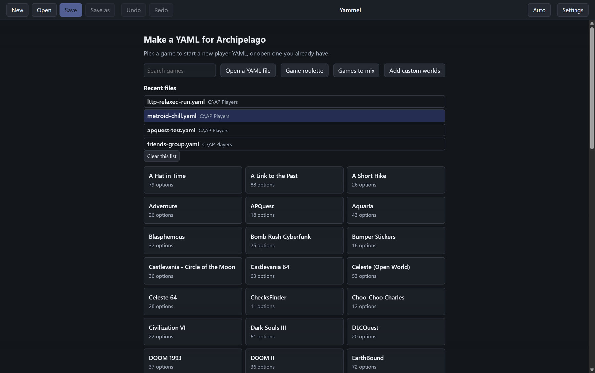](images/01-start-screen.jpg)

Pick any game to start a new YAML, open one you already have, or jump back into a recent file. Game roulette and Games to mix are one click away. Custom worlds can be added from here too.

### 2. A short welcome, once

[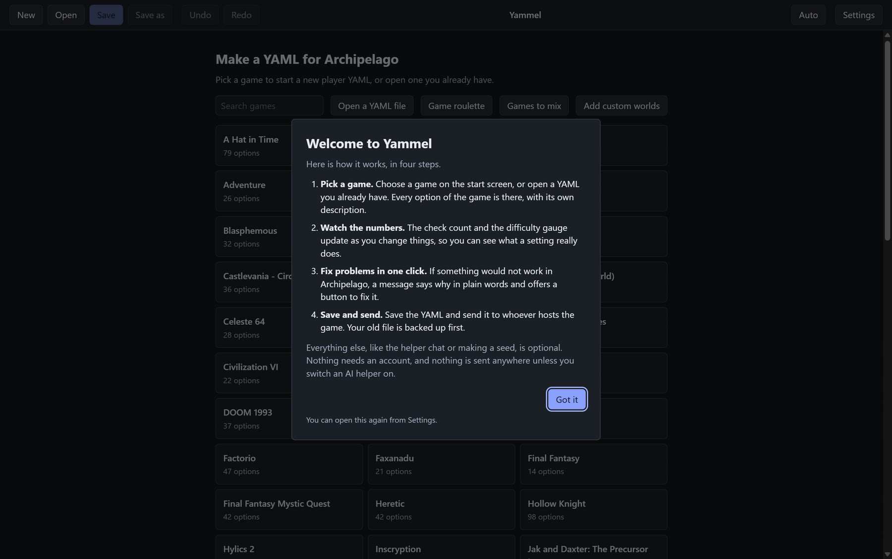](images/25-welcome-card.jpg)

The first time Yammel opens, a four-step card explains how it works: pick a game, watch the numbers, fix problems in one click, save and send. It appears once, and Settings can show it again.

### 3. Find a game fast

[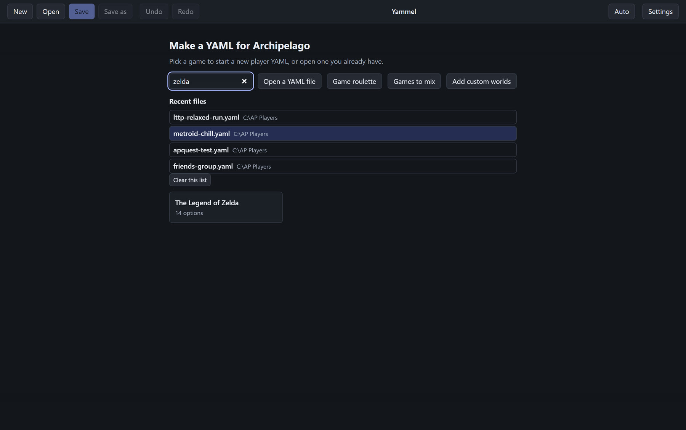](images/02-search-games.jpg)

Search across every bundled game. Games you add yourself are tagged so you can tell them apart.

## Editing

### 4. Every option, in plain words

Each option is a card with the game's own description, grouped and searchable. The YAML writes itself live on the right. Above the options: the live check count (259 here), a 0 to 10 difficulty gauge, and the problem checker saying whether Archipelago will accept the file.

### 5. "Why this number?"

[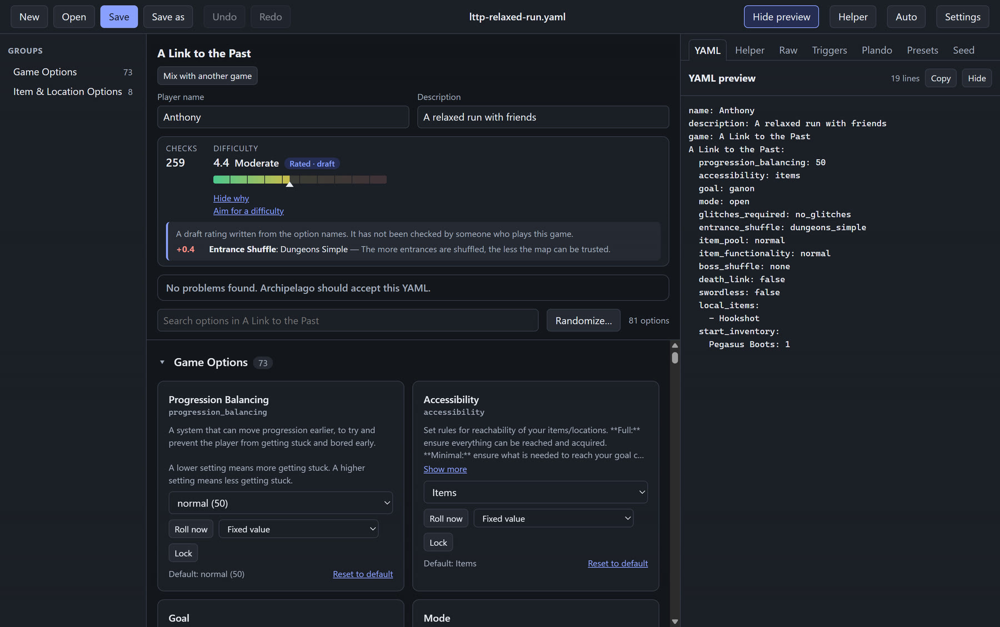](images/04-difficulty-why.jpg)

The difficulty gauge is never a black box. Open it and every setting that moved the score is listed with how much, and drafts are labelled as drafts.

### 6. Drag to the difficulty you want

[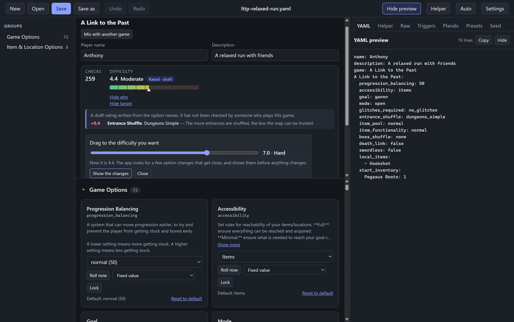](images/04b-aim-for-a-difficulty.jpg)

Pick a target on the slider and the app finds a few option changes that land close to it, and shows them with the before and after score. Nothing changes until you press Apply, options you locked are left alone, and one undo puts it all back. Offered for games with a rating.

### 7. Weighted values, with percentages

Any switch, choice or number can be weighted. The chances are shown as percentages as you type, and Make all equal fixes the odds in one click.

### 8. Everything updates together

[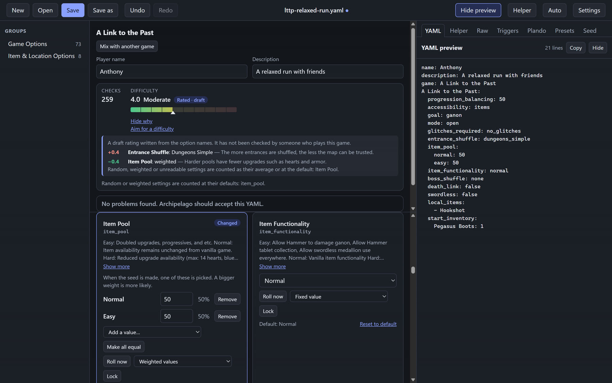](images/06-weighted-option-full.jpg)

Changing odds updates the YAML, the difficulty estimate and the problem checker at once. Every change is one undo step.

### 9. Randomize, on your terms

[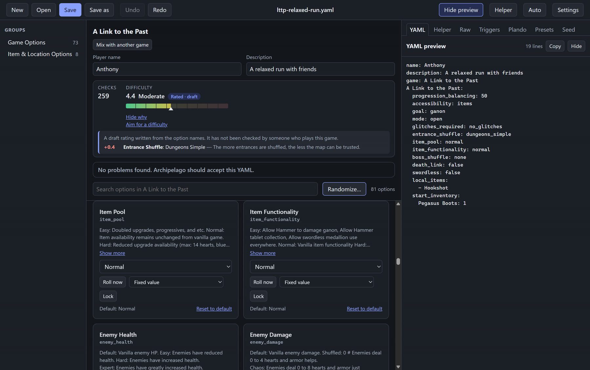](images/07-randomize-panel.jpg)

Roll one option or everything at once. Lock the options you care about and optionally keep the result inside a difficulty band. It writes standard Archipelago random values.

### 10. A helper that shows its work first

Say what you want in plain words ("make it a bit harder"). The built-in guide runs on your computer and sends nothing anywhere. It shows the change and the effect on difficulty, and nothing happens until you press Apply. Claude Code, Codex or your own OpenRouter key can be switched on for open-ended requests.

### 11. The helper in its own window

Pop the helper out and keep it beside the editor. The conversation comes with it, and Apply, Skip and Show me work from there: changes land in the YAML that is open in the editor, and undo works as usual. Closing the window puts the same conversation back in the editor.

### 12. Raw text when you want it

A two-way text view for anything the cards do not cover. Comments and layout are kept exactly as you wrote them.

## Checking

### 13. Make a seed from the editor

[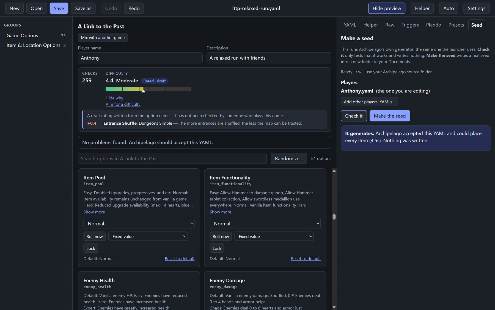](images/10-make-a-seed.jpg)

Runs Archipelago's own generator on your YAML (and other players' YAMLs if you add them). Check it tests that it works and writes nothing; Make the seed writes a real seed to a new folder. Stop really stops it.

### 14. It reads your YAML the way Archipelago will

A typo in a choice, a number out of range, a misspelled option, a switch set to "ture": the checker explains each problem in plain words before Archipelago stops with an error. Most have a one-click fix.

### 15. Fixed in one undo step

[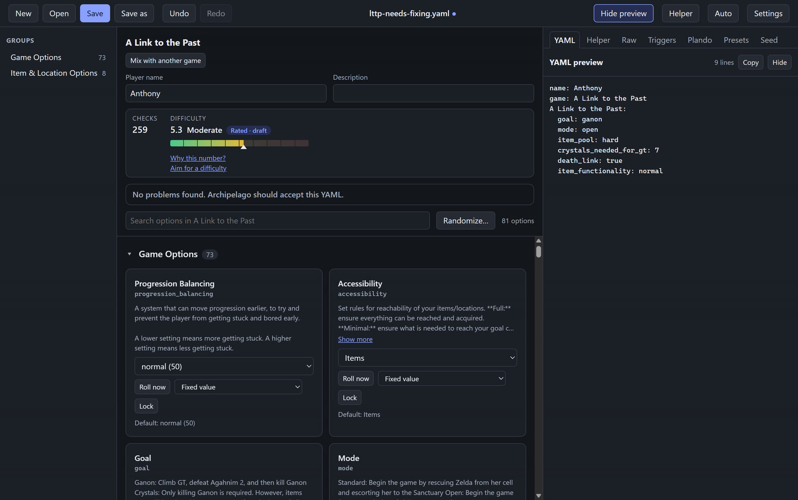](images/12-problems-fixed.jpg)

Apply the suggested fixes clears them together, and undo puts everything back. The checker was tested against Archipelago's own option code on more than 22,000 values.

## Ideas and shortcuts

### 16. Presets: the game's own, and yours

[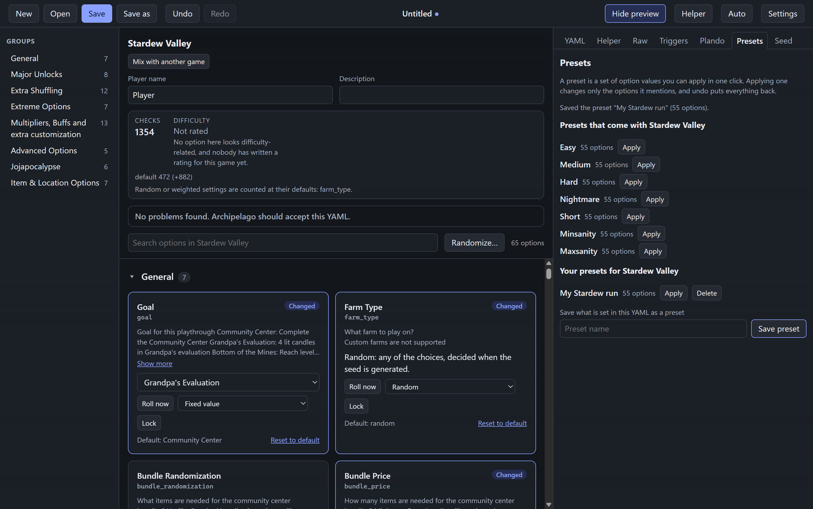](images/13-presets.jpg)

Games that ship presets (Stardew Valley's Easy to Maxsanity here) apply in one click. Save what you have set as your own named preset and reuse it later. Applying changes only the options it mentions.

### 17. Games to mix

Ten ideas for two games that go well together, with the reasons shown and sliders to change what counts. One click opens a YAML that mixes them. Works with nothing installed.

### 18. Game roulette

[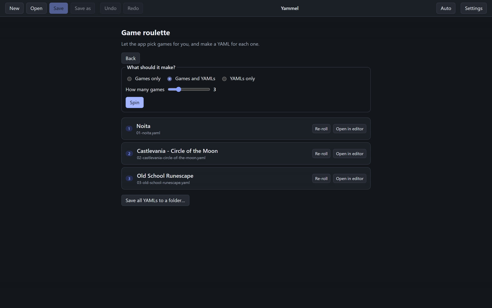](images/15-game-roulette.jpg)

Let the app pick one to ten games and make a YAML for each. Re-roll any one, open it in the editor, or save them all to a folder.

### 19. Files with several players

[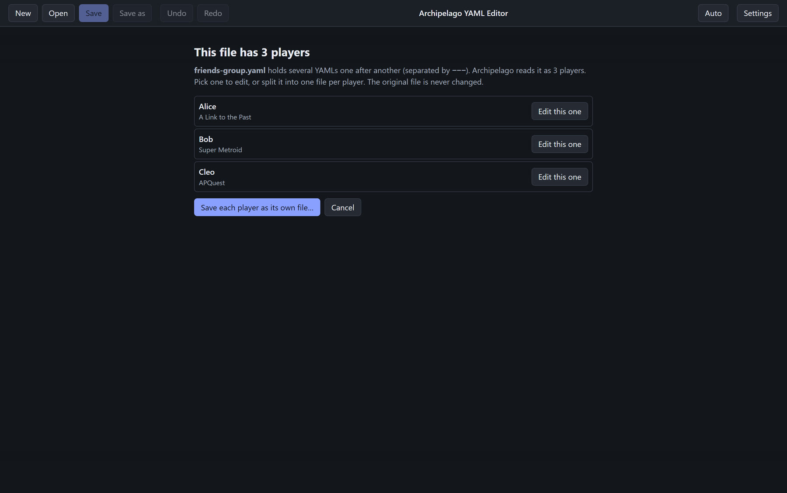](images/16-several-players-in-one-file.jpg)

A file holding several YAMLs (separated by ---) is split into its players. Edit one, or save each as its own file. The original is never changed.

## Triggers and plando

### 20. Triggers, built from cards

[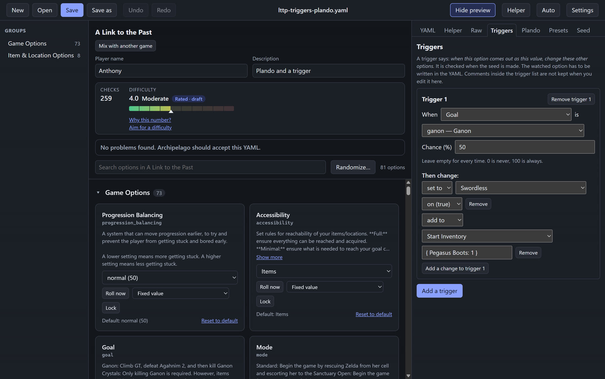](images/26-triggers-tab.jpg)

A trigger says: when this option comes out as this value, change those options. Pick the option and value from the game's own lists, add a chance, and choose what to set, add to or take from. The checker knows what Archipelago really does, for example that a trigger whose watched option is not written in the YAML makes it stop.

### 21. Plando: place items yourself

[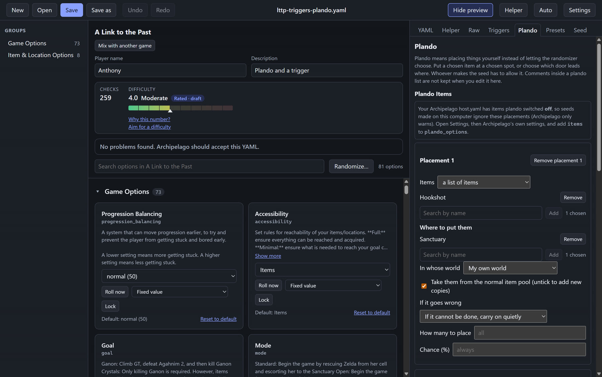](images/27-plando-items.jpg)

Put chosen items at chosen locations, in your own world or someone else's, from the pool or as new copies, with a count, a chance and a choice of what happens if it cannot be done. The tab also tells you whether Archipelago's host.yaml has item plando switched on, because when it is off Archipelago ignores the placements without stopping.

### 22. Plando: choose which door leads where

[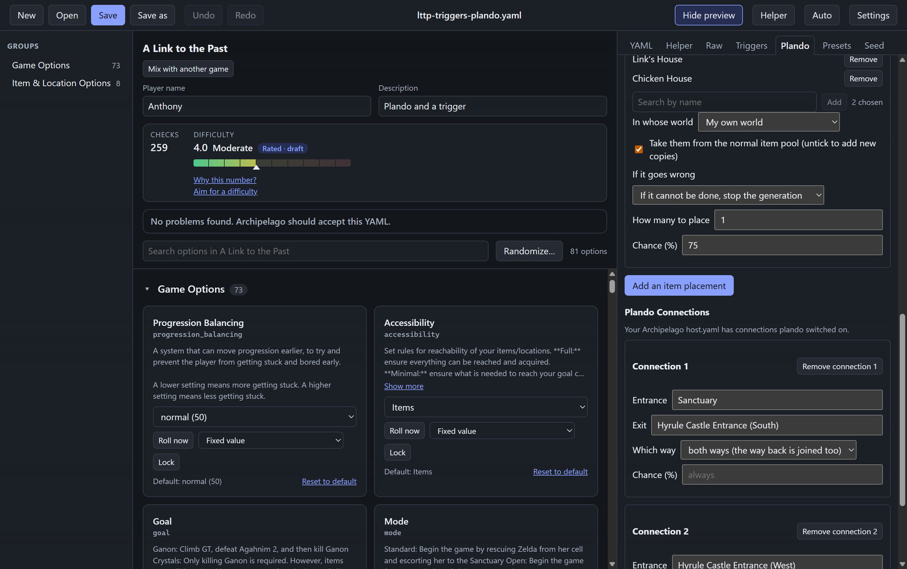](images/28-plando-connections.jpg)

For the games that support it, pick an entrance and an exit from the game's real names and say which way the connection goes. Names that do not exist, repeated entrances and wrong directions are caught with a fix before Archipelago would stop on them.

## Your own worlds

### 23. Custom worlds, built in

[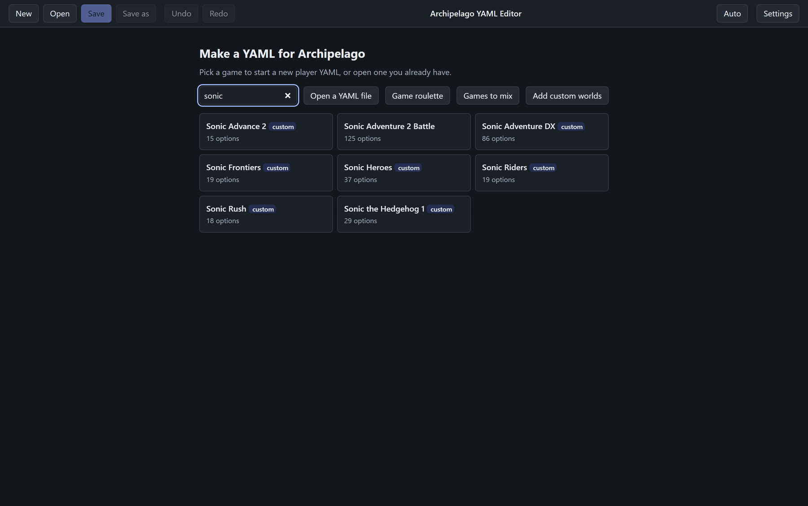](images/17-custom-games-tagged-in-the-list.jpg)

Choose the folder your extra games live in and the editor reads each one the way Archipelago does, learns its options, and adds it to the game list tagged custom.

### 24. Settings: all optional

[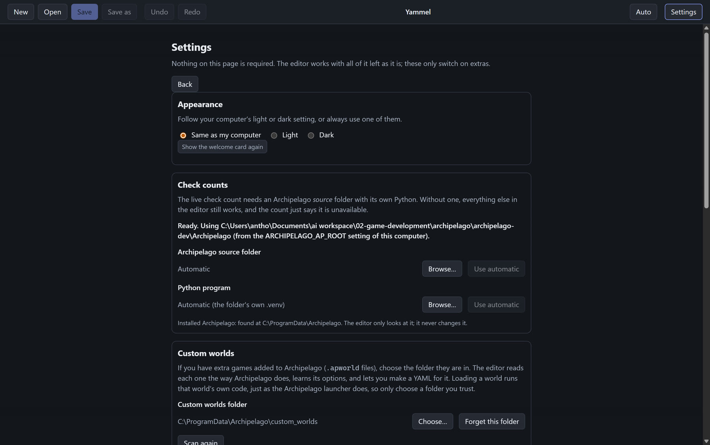](images/18-settings.jpg)

Nothing on this page is required. It only switches extras on: light or dark look (or follow your computer), check counts, custom worlds, Archipelago's own settings file, and the optional AI helpers.

### 25. 181 custom games found in one scan

[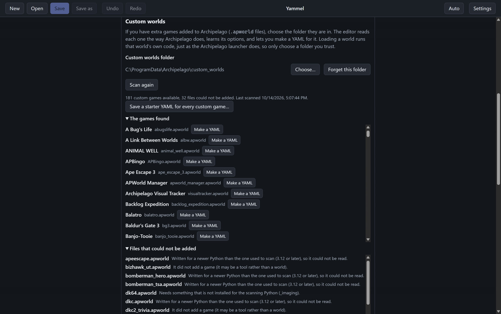](images/19-custom-worlds-scan.jpg)

A real scan of a folder of 227 custom worlds: 181 games added with all their options. Files that cannot be read are listed with a plain reason (most were written for a newer Python) and never stop the rest. Make a YAML for any game, or save a starter YAML for all of them.

## Archipelago's own settings

### 26. host.yaml as a form

[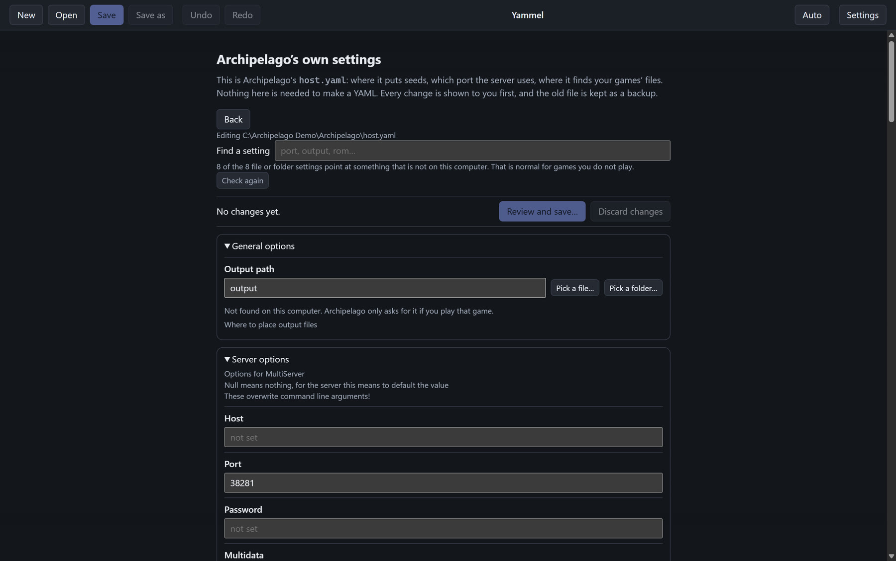](images/20-host-settings-form.jpg)

Archipelago's settings file shown with the file's own explanations, a search box, dropdowns where the file lists the choices, and file and folder pickers for paths. A quiet note appears under a path that points at something not on the computer, which is normal for games you do not play.

### 27. See exactly what will change

Before anything is written you see only the lines that change. The old file is backed up first, comments and line endings are kept, and a save is refused if something else changed the file meanwhile.

## Light theme

### 28. Light, dark, or follow your computer

[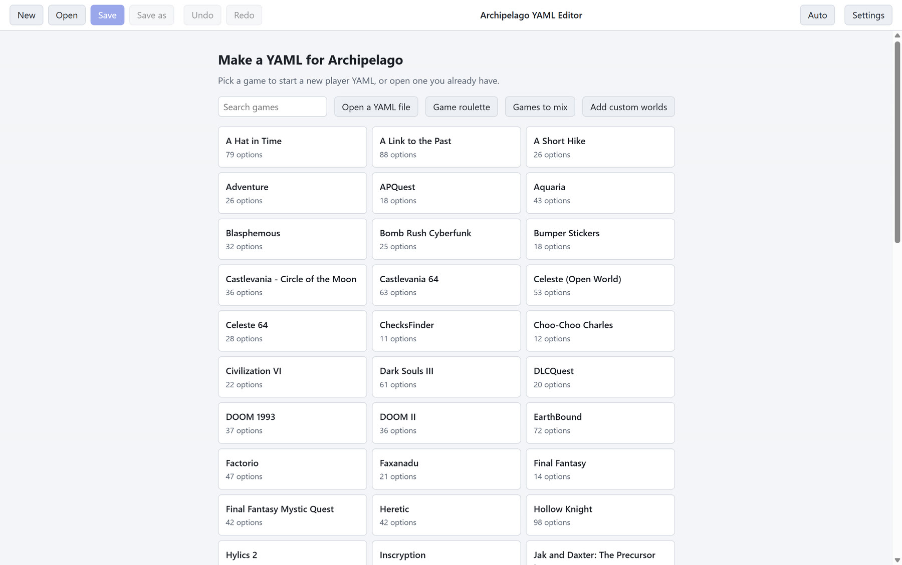](images/22-light-start-screen.jpg)

Switch the look from the toolbar button or in Settings. The app can follow your system's light or dark setting. Every screen is checked for overlapping or clipped text, unnamed controls, low contrast and invisible keyboard focus, in both looks, at small window sizes.

### 29. The same editor, in light

[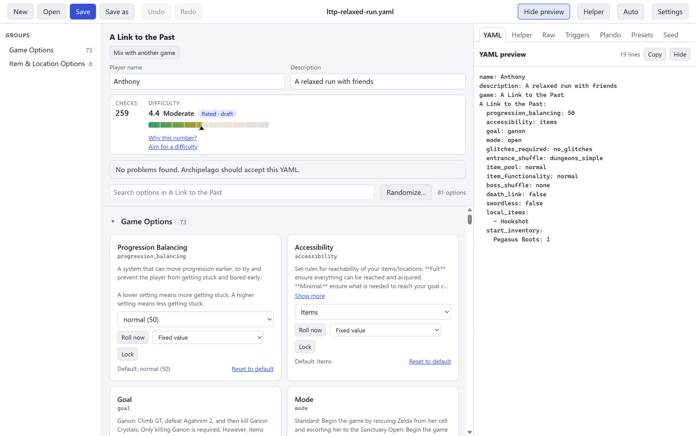](images/23-light-editor-overview.jpg)

Same layout, same live checks, same difficulty gauge.

### 30. Problems stay readable

[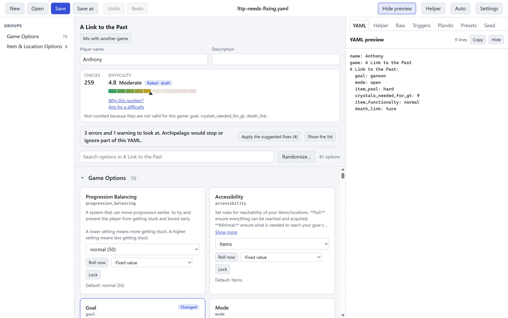](images/24-light-problem-checker.jpg)

Errors, warnings and fixes keep their meaning in both themes.

---

Back to the [documentation index](README.md) or the [main page](../README.md).
